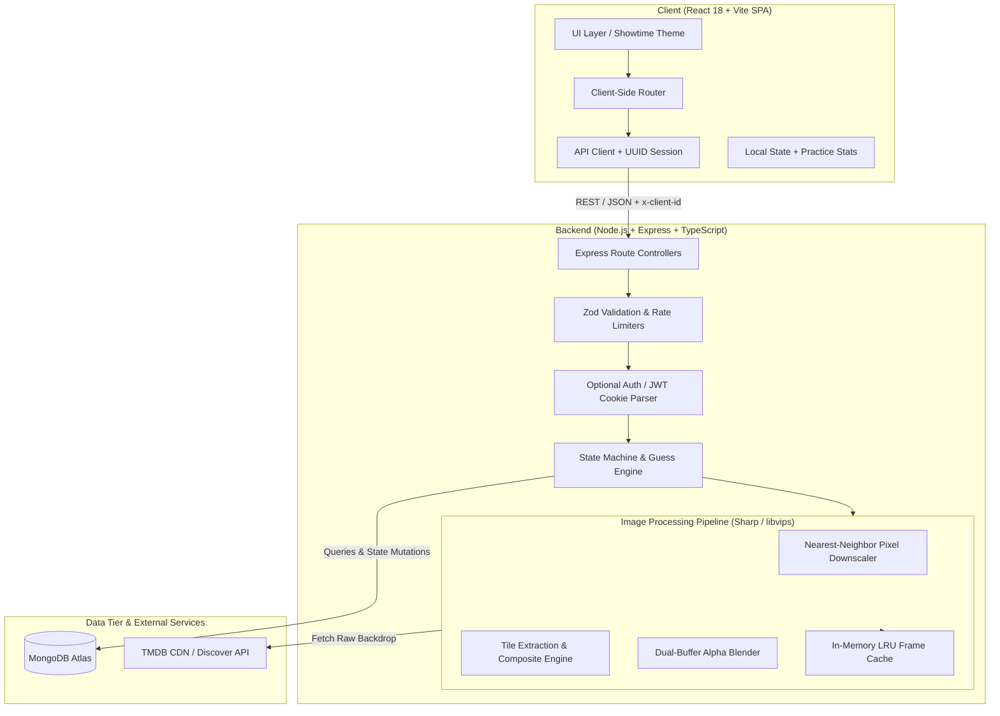

# 🎬 Blurdle — Production-Grade Daily Movie Guesser

[](https://www.typescriptlang.org/)
[](https://react.dev/)
[](https://nodejs.org/)
[](https://expressjs.com/)
[](https://www.mongodb.com/)
[](https://sharp.pixelplumbing.com/)
[](https://tailwindcss.com/)

> **Live Demo:** [https://blurdle-five.vercel.app](https://blurdle-five.vercel.app)  
> **API Service:** [https://blurdle.onrender.com](https://blurdle.onrender.com)  
> *Note: This project consumes the TMDB API but is not certified or endorsed by TMDB.*

---

## 📌 Executive Summary

**Blurdle** is a full-stack, daily movie-guessing web platform designed around server-side computational image processing, strict anti-cheat state synchronization, and modular game modes. 

While inspired by Wordle-style daily rituals, Blurdle solves non-trivial engineering challenges:
1. **Server-Side Anti-Cheat & Leak Prevention:** Eliminates client-side bypasses (e.g., inspecting network payloads or disabling CSS filters) by synthesizing downsampled, masked, or blended binary PNG frames on the fly using libvips/Sharp.
2. **Progressive Gating Pipeline:** Enforces mathematical state verification on the server before serving higher-resolution frames or reveals.
3. **Multi-Mode State Machine:** Supports four distinct gameplay archetypes (Classic Pixelation, Flashlight Tile Grid, Double Exposure Blending, and Unreliable Narrator Persona Hints), plus an isolated Practice Reel.
4. **Seamless Identity Merging:** Zero-friction guest-first play via persistent UUID headers (`x-client-id`), with atomic migration into persistent JWT accounts upon registration.

---

## 🏗️ System Architecture



---

## 🎯 Game Modes & Mechanics

| Mode | Visual Engine | Guess Budget | Win Condition | Level/Hint Progression |
|---|---|:---:|---|---|
| **Classic** | 2-pass Sharp pixelation (downscaled to 8–128px, nearest-neighbor upscale) | 6 guesses | Identify title | Resolution sharpens on wrong guess; decade unlocked at 3, genres at 4 |
| **Flashlight** | 6×4 (24 tiles) dynamic canvas composite with alpha-masked tile extraction | 3 lives | Identify title | Uncover dark tiles; score = `100 - (3 * tiles) - (10 * wrong_guesses)` |
| **Double Exposure** | Pixel-level alpha compositing of two distinct film backdrops (50/50, 65/35, 35/65) | 6 guesses | Identify **both** titles | Correct guess locks that film slot; wrong guess shifts exposure bias |
| **Unreliable Narrator** | Idiosyncratic persona clue hierarchy (Noir Detective, Sports Broadcaster, etc.) | 4 guesses | Identify title | 1st hint is atmospheric; wrong guesses reveal concrete plot & climax clues |
| **Practice Reel** | Unlimited rounds across all 4 modes; difficulty toggles (Relaxed/Standard/Hard) | Configurable | Zero streak pressure | Separate film pool (213+ movies, 0 daily overlap); 48h TTL session cleanup |

---

## 💡 Key Engineering Challenges & Technical Decisions

### 1. Zero-Leak Server-Side Image Synthesis
* **Problem:** Frontends that use CSS `blur()`, canvas pixelation filters, or preload full-resolution backdrops expose the answer to anyone opening DevTools Network/Elements tabs.
* **Solution:** The server fetches high-resolution backdrops from TMDB and caches the raw buffers in memory. The client never receives full images during active rounds. Instead, `/api/puzzle/today/frame?level=N` dynamically computes:
  - **Classic:** Downscales the buffer to small widths (`8, 16, 32, 64, 128`), then upscales back to `780px` using Sharp's `kernel.nearest` interpolation.
  - **Flashlight:** Generates a solid `#050508` base canvas, extracts only the client's unlocked `tileWidth × tileHeight` sub-rectangles from the source buffer, and composites them on top. Unrevealed pixels do not exist in the response payload.
  - **Double Exposure:** Modifies the raw byte stream of the top layer's alpha channel (`rawImg2[i] = Math.round(rawImg2[i] * opacity)`) before blending onto the bottom layer.
* **Server-Side Level Gating:** If a client requests `level=4` when their session has only made 1 guess, the controller throws `403 Forbidden`. Answers (`title`, `year`, `backdropPath`) are strictly omitted from JSON payloads until the document status evaluates to `won` or `lost`.

### 2. High-Performance In-Memory LRU Frame Caching
* **Problem:** Running image decoding, resizing, and encoding on every HTTP request can quickly exhaust CPU resources on free/shared tiers.
* **Solution:** Implemented a bounded in-memory LRU cache (`Map<string, Buffer>` capped at 150 entries per mode). Cache keys are deterministic hashes of puzzle IDs, levels, or revealed tile sets (e.g. `flashlight-104-2,5,11`). Hits bypass both TMDB network latency and Sharp CPU encoding entirely.

### 3. Guest-First Architecture with Frictionless Auth Merging
* **Problem:** Forcing registration drops conversion; relying solely on `localStorage` causes data loss across devices or browsers.
* **Solution:**
  - Every client generates a persistent UUID (`pixel-frame-client-id`) passed via the custom `x-client-id` header.
  - Games and statistics are tied to `clientId`.
  - When a player registers, an atomic migration endpoint (`POST /api/auth/merge`) updates all historical `Game` and `ModeGame` records matching their `clientId` to their new `userId`.
  - Authentication uses stateless JWTs issued via `httpOnly`, `SameSite: None`, `Secure` cookies, keeping API calls declarative.

### 4. Dual-Pool Isolation & Zero Spoiler Overlap
* **Problem:** Players using the Practice mode might encounter upcoming or current daily puzzle answers.
* **Solution:**
  - Daily answers reside in `Movie`; practice films reside in `PracticeMovie`.
  - The seed pipeline (`seed-practice.ts`) queries all existing daily `tmdbId`s and applies strict `$nin` exclusion before upserting into the practice collection.
  - Runtime verification (`npm run test:practice`) confirms **0 overlapping films across pools**.
  - Autocomplete search queries both collections using an `$or` union deduplicated by `tmdbId` without exposing which collection a title originated from.

---

## 🗄️ Database Design & Indexing Strategy

```
Collections:
├── DailyPuzzle           (Daily classic puzzles, dateKey index)
├── ModePuzzle            (Daily mode puzzles, compound unique on mode + dateKey)
├── Movie                 (Daily master pool, unique tmdbId, normalizedTitle index)
├── Game                  (Classic game instances, compound unique on clientId + puzzleNumber)
├── ModeGame              (Mode game instances, compound unique on clientId + mode + puzzleNumber)
├── User                  (Registered users, unique lowercase email index)
├── PracticeMovie         (Practice pool, unique tmdbId, normalizedTitle index)
├── PracticeNarratorEntry (Narrator hints pool, unique tmdbId)
└── PracticeRound         (Active/historical practice sessions, 48-hour TTL index)
```

### Key Performance Indexes
- **Session Lookups:** `{ clientId: 1, mode: 1, puzzleNumber: 1 }` (unique compound index for O(1) game state resolution).
- **TTL Expiration:** `PracticeRoundSchema.index({ updatedAt: 1 }, { expireAfterSeconds: 172800 })` — MongoDB automatically cleans up abandoned practice rounds after 48 hours.
- **Prefix Autocomplete:** `{ normalizedTitle: 1 }` enables rapid B-tree regex prefix scans (`^title`).

---

## 🔌 API Specification (Selected Endpoints)

### Daily Modes
| Endpoint | Method | Headers / Auth | Description |
|---|:---:|---|---|
| `/api/puzzle/today` | `GET` | `x-client-id` | Retrieves today's Classic puzzle state (answers redacted if playing) |
| `/api/puzzle/today/frame?level=N` | `GET` | `x-client-id` | Returns binary PNG. Throws `403` if `level > guessesUsed + 1` |
| `/api/guess` | `POST` | `x-client-id` | Submits `{ tmdbId }`. Evaluates correctness & updates game status |
| `/api/modes/:mode/today` | `GET` | `x-client-id` | Resolves or creates today's puzzle state for specific game mode |
| `/api/modes/flashlight/reveal` | `POST` | `x-client-id` | Unlocks tile `0-23`. Updates state and validates life budget |
| `/api/modes/overview` | `GET` | `x-client-id` | Returns status summary across all 4 modes for the Home hub |

### Practice Reel
| Endpoint | Method | Headers / Auth | Description |
|---|:---:|---|---|
| `/api/practice/search?q=:query` | `GET` | `x-client-id` | Autocomplete across combined Daily + Practice pools |
| `/api/practice/:mode/start` | `POST` | `x-client-id` | Starts round with `{ difficulty, genre, decade }`. Conceals answer |
| `/api/practice/rounds/:id/frame` | `GET` | `x-client-id` | Returns gated mode-specific frame buffer |
| `/api/practice/rounds/:id/guess` | `POST` | `x-client-id` | Submits guess, deducts lives, or adjusts exposure level |

---

## 🧪 Automated Testing & Verification

The project includes purpose-built automated verification scripts that validate business logic, image processing, and data integrity:

```bash
# 1. Verify Sharp frame generation & scoring mathematics across all modes
npm --prefix server run test:modes

# 2. Verify Practice isolation, level gating, difficulty logic, & zero spoiler overlap
npm --prefix server run test:practice

# 3. Verify TypeScript build and production bundle compilation
npm --prefix server run build
npm --prefix client run build
```

### Verification Assertions Covered:
- ✅ Sharp tile-extraction generates valid non-leaking PNG buffers.
- ✅ Sharp alpha-composition properly computes 35%, 50%, and 65% transparency layers.
- ✅ Autocomplete search returns sanitized objects without exposing internal MongoDB `_id`s or source pool tags.
- ✅ Practice mode strictly excludes all 332 daily movies (0 spoiler overlap).
- ✅ Practice rounds never alter `DailyPuzzle`, `ModePuzzle`, `Game`, or `ModeGame` document counts.

---

## 🚀 Local Development Setup

### Prerequisites
- Node.js ≥ 20.x
- MongoDB (local instance or free Atlas URI)
- Free TMDB API Key ([themoviedb.org](https://www.themoviedb.org/))

### 1. Clone & Install Dependencies
```bash
git clone https://github.com/farazahhmad/blurdle.git
cd blurdle

# Install backend dependencies
cd server
npm install

# Install frontend dependencies
cd ../client
npm install
```

### 2. Configure Environment Variables

**`server/.env`:**
```env
PORT=3001
MONGODB_URI=mongodb+srv://<user>:<password>@cluster0.p5r85na.mongodb.net/blurdle?retryWrites=true&w=majority
TMDB_API_KEY=your_tmdb_api_key_here
CLIENT_ORIGIN=http://localhost:5173
JWT_SECRET=super_secret_jwt_key_at_least_32_characters
```

**`client/.env`:**
```env
VITE_API_URL=http://localhost:3001/api
VITE_SITE_URL=http://localhost:5173
```

### 3. Seed Database
```bash
# Populate daily film answer pool from TMDB
npm --prefix server run seed

# Seed practice pool (strictly isolated from daily pool)
npm --prefix server run seed:practice

# (Optional) Seed background poster wall & narrator hints
npm --prefix server run seed:bg
npm --prefix server run seed:narrator
```

### 4. Run Development Servers
```bash
# Terminal 1: Start Express API server (port 3001)
npm --prefix server run dev

# Terminal 2: Start Vite Client (port 5173)
npm --prefix client run dev
```

Visit `http://localhost:5173` in your browser.

---

## 📦 Production Deployment

### Frontend (Vercel)
- **Root Directory:** `client`
- **Build Command:** `npm run build`
- **Output Directory:** `dist`
- **Environment Variables:**
  - `VITE_API_URL`: `https://your-api.onrender.com/api`
  - `VITE_SITE_URL`: `https://your-app.vercel.app`

### Backend (Render)
- **Root Directory:** `server`
- **Build Command:** `npm install && npm run build`
- **Start Command:** `npm start`
- **Environment Variables:**
  - `MONGODB_URI`: Atlas connection string
  - `TMDB_API_KEY`: TMDB v3 API Key
  - `JWT_SECRET`: Random 32+ character string
  - `NODE_ENV`: `production`

---

## 👨‍💻 Engineering Highlights for Interviews

When discussing this project in technical interviews, key topics to highlight include:
- **System Defense Against Client Manipulation:** Why image manipulation belongs on the server when cheating undermines core gameplay.
- **Buffer-Level Performance Tuning:** Using raw pixel buffers, stream piping, and LRU maps in Node.js rather than disk I/O.
- **State Machine Architecture:** How different game models share underlying abstractions while isolating distinct rules and win/loss states.
- **Safe Database Schema Evolution:** Designing backward-compatible schemas with optional fields, compound indexes, and TTL garbage collection.
